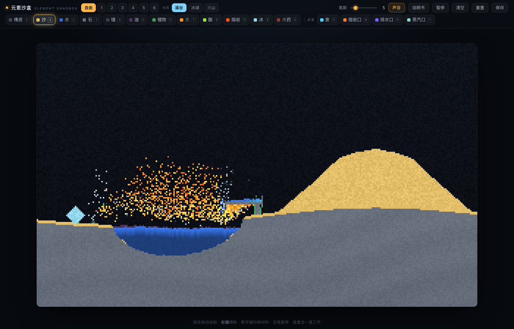

# 元素沙盒 · Element Sandbox

**Element Sandbox** — 一个 300 × 180 网格的粒子物理沙盒。13 种材料各自遵循下落、流动、燃烧、腐蚀、相变的规则，4 种装置持续产出或吞噬材料，所以整张地图会一直自己运转。纯 HTML / CSS / JavaScript 单文件实现，无外部图片、字体和音频依赖。

游戏文件：[index.html](index.html)。克隆仓库后在本地打开，或参考下方说明启动静态服务器。



## 游戏简介

没有目标，也没有预算限制——画什么就发生什么。沙会沉进水底，水会把油托起来，火会顺着油面铺开，酸会一路沉到池底把石头蚀穿。

- **13 种材料**：沙、水、石、墙、油、植物、火、酸、熔岩、冰、火药、蒸汽、烟
- **4 种装置**：泉、熔岩口、排水口、蒸汽口——放下去就一直工作
- **6 个关卡**：每关只给 2～3 种材料，用目标条推进
- **3 张自由地图**：溪谷、冰湖、火山，各自有独立的水/熔岩循环
- **全局风场**：约 80 秒转一圈，烟、蒸汽和火苗会顺着风歪
- **内置说明书**：每个材料的个体属性和交互属性都能查
- **原创合成音效**：无音频素材，火焰轰鸣、蒸汽嘶声、爆炸全部用 Web Audio 实时合成

## 如何开始

直接双击 `index.html`，或在仓库根目录启动静态服务器后访问：

```text
http://localhost:8000/games/element-sandbox/
```

浏览器会拦截自动播放的声音，**点一下画面任意位置**即可开启音效（导航栏的「声音」按钮可以随时静音）。

## 操作方式

| 操作 | 桌面 | 手机 |
| --- | --- | --- |
| 绘制材料 | 按住左键拖动 | 按住拖动 |
| 擦除 | 按住右键拖动 | 切到「橡皮」 |
| 切换材料 | 点击工具条，或按 `1`～`9`、`0`、`E`、`G`、`Q`、`W`、`R`、`T` | 点击工具条 |
| 调整笔刷 | 导航栏滑杆 | 导航栏滑杆 |
| 暂停 / 继续 | `Space` 或「暂停」 | 「暂停」 |
| 查看说明书 | 「说明书」按钮 | 同左 |
| 切换关卡 / 地图 | 导航栏胶囊 | 同左 |
| 保存截图 | 「保存」按钮 | 同左 |

## 关卡

| # | 关卡 | 只给 | 目标 |
| --- | --- | --- | --- |
| 1 | 火烧连营 | 火 · 油 | 烧光整片树林 |
| 2 | 引水入田 | 橡皮 · 沙 · 墙 | 挖渠把水引进田地 |
| 3 | 沙沉湖底 | 沙 · 墙 | 往湖里填沙，把湖底垫起来 |
| 4 | 爆破拆除 | 火药 · 火 · 墙 | 炸掉石桥 |
| 5 | 酸蚀通路 | 酸 · 水 · 墙 | 用酸蚀穿石板，放水下去 |
| 6 | 石桥横跨 | 水 · 冰 · 墙 | 用水浇熔岩，在峡谷上架出石桥 |

通关记录保存在浏览器本地。

## 技术说明

- 固定 **60 帧 / 秒** 逐格更新，`Uint8Array` 存材料与寿命，单步约 **0.25 ms**
- 密度决定分层：油 600 &lt; 水 1000 &lt; 酸 1050 &lt; 熔岩 2200，粉末（沙 900、火药 800）会沉进任何液体
- 燃烧的本质是「把邻居变成火」，没有可燃物就自动熄灭
- 音效由白噪声经过不同的滤波器与包络实时合成，音量跟随画面上的火焰与蒸汽数量
- 全部渲染走 Canvas 2D：模拟层 300×180 的 `ImageData` 放大 4 倍、关闭平滑

## 调试

在 URL 后加 `?debug` 会暴露 `window.__sb`，可以调用 `step()`、`loadLevel(i)`、`setMap(i)`、`goal()` 等接口，方便二次开发或自动化测试。
