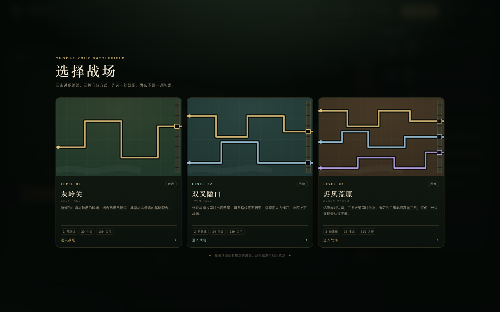
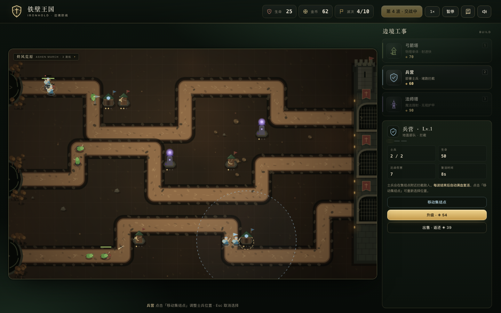
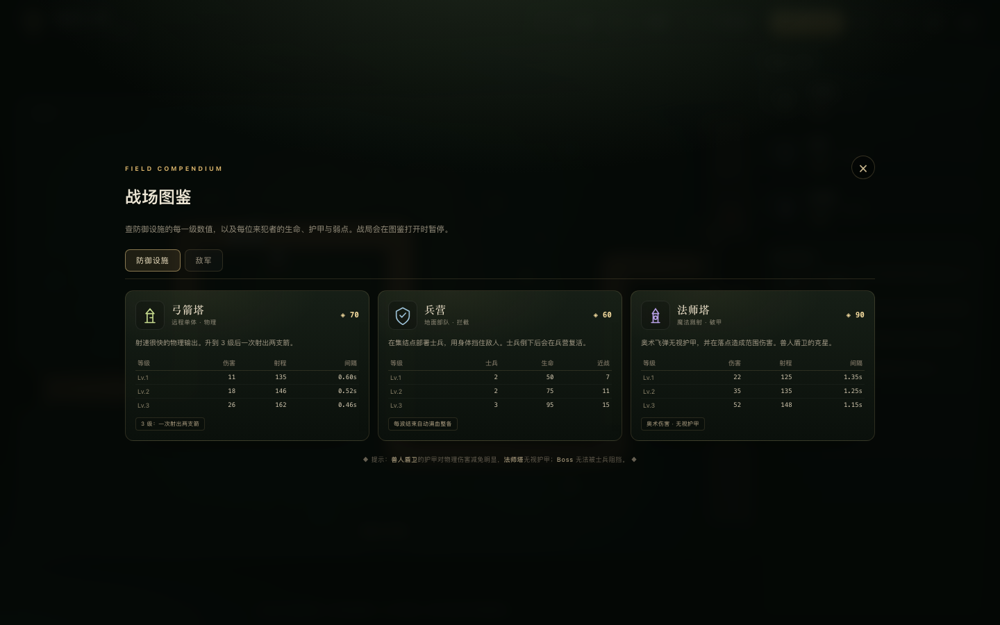

# 铁壁王国 · 中世纪塔防

**Ironhold Tower Defense** — 一款受《王国保卫战》启发的轻量中世纪塔防游戏。纯 HTML / CSS / JavaScript 单文件实现，无外部图片、字体和音频依赖。

游戏包含 **3 张战场地图**，每张地图有 **1–3 条独立进攻路线**。从单线峡谷到三线围攻，需要根据路线分布调整塔位和兵营集结点。

游戏文件：[index.html](index.html)。克隆仓库后在本地打开，或参考下方说明启动静态服务器。







## 游戏简介

灰岭关是王国边境的入口，但敌人并不只从一条山路来。哥布林、座狼骑兵和兽人盾卫会从北坡、南谷与荒原同时压上，最终还有一只食人魔首领压阵。建起你的防线，守住城堡。

- **3 张独立战场地图**：灰岭关、双叉隘口、烬风荒原
- **多路线防守**：路线数量从 1 条增加到 3 条，需要兼顾视野和火力
- **3 种防御设施**：弓箭塔、兵营、法师塔
- **可阻挡敌人的士兵**：兵营会在地面部署士兵，与敌人近战
- **可移动集结点**：点开兵营的「移动集结点」，点一次地面即可完成并自动退出
- **每波结束士兵满血整备**：清完一波后，士兵自动满血复活并回到集结点
- **战场图鉴**：随时查看三种设施每级数值与四种敌人的生命、护甲和弱点
- **每关 10 波敌军 + Boss 战**
- **升级与出售**：每座建筑 3 个等级
- **关卡选择、下一关、重战本关**
- **暂停、1×/2× 倍速、重开**
- **桌面与手机自适应**
- **原创合成音效**：无音频素材，全部通过 Web Audio API 实时合成

## 关卡

| 关卡 | 难度 | 路线 | 初始生命 | 初始金币 | 特点 |
| --- | --- | --- | --- | --- | --- |
| 灰岭关 | 普通 | 1 条 | 20 | 180 | 蜿蜒单线峡谷，适合熟悉基础节奏 |
| 双叉隘口 | 进阶 | 2 条 | 24 | 230 | 北坡与南谷互不相通，必须分兵布防 |
| 烬风荒原 | 困难 | 3 条 | 28 | 300 | 三条大道同时告急，考验全图覆盖 |

每关胜利后可进入下一关；游戏中点击战场左上角的关卡标牌，可以重新选择战场或继续当前战局。

## 如何开始

直接双击 `index.html`，或在仓库根目录启动静态服务器后访问：

```text
http://localhost:8000/games/ironhold-tower-defense/
```

打开后先选择一处战场，再开始布防。

## 操作方式

| 操作 | 桌面 | 手机 |
| --- | --- | --- |
| 选择建筑 | 点击右侧卡片，或按 `1` / `2` / `3` | 点击下方建筑卡片 |
| 建造 | 点击草地格子 | 点击草地格子 |
| 查看 / 升级 / 出售建筑 | 点击已建成的建筑，在侧栏操作 | 点击建筑，在下方操作 |
| 移动兵营集结点 | 选中兵营 → 点击「移动集结点」→ 点击附近地面（自动退出） | 选中兵营 → 点「移动集结点」→ 点地面 |
| 打开 / 关闭图鉴 | `C` 或顶栏书本按钮 | 顶栏书本按钮 |
| 切换关卡 | 点击战场左上角关卡标牌 | 点击战场左上角关卡标牌 |
| 暂停 | `Space` 或顶栏按钮 | 顶栏按钮 |
| 切换倍速 | `F` 或 `1×` 按钮 | 顶栏按钮 |
| 取消选择 | `Esc` | 点击空草地 |

## 防御设施

| 设施 | 造价 | 定位 |
| --- | --- | --- |
| 弓箭塔 | 70 | 物理单体远程，攻速快；3 级后一次射出两支箭 |
| 兵营 | 60 | 部署 2–3 名士兵拦截敌人；士兵阵亡后会在兵营复活 |
| 法师塔 | 90 | 魔法范围伤害，完全无视护甲，克制兽人盾卫 |

- 升级费用约为原造价的 0.9× / 1.4×。
- 出售返还累计投入金币的 65%。
- 兵营士兵脱战后会缓慢回血；**每波结束时自动满血复活**。
- 选中兵营不会立刻进入设置集结点状态，需要主动点击「移动集结点」；放置后自动退出。
- Boss 免疫阻挡。

## 敌人

| 敌人 | 特点 |
| --- | --- |
| 哥布林 | 基础单位，数量多 |
| 座狼骑兵 | 移动速度很快 |
| 兽人盾卫 | 高生命、高护甲，适合用魔法处理 |
| 食人魔首领 | 最终波 Boss，高生命、免疫士兵阻挡 |

## 玩法提示

1. 先观察路线分布，再决定兵营放在哪条路、覆盖哪一片区域。
2. 不确定数值时按 `C` 打开图鉴：里面有每座塔的逐级伤害、射程与敌人护甲。
3. 面对兽人盾卫时，法师塔的收益远高于纯物理输出。
4. 选中兵营 → 「移动集结点」→ 点击地面，可以把集结点调整到更靠近拐角的位置。
5. 双线、三线地图不要只堆一条路，至少为每条路线留一座输出塔。
6. 如果漏怪较多，可以优先升级已有塔，而不是继续铺低级塔。
7. Boss 无法被士兵阻挡，最终波需要足够的远程伤害。

## 技术细节

- 单个 `index.html`，内联 CSS 与 JavaScript
- 路线、主题、敌军倍率和初始资源均由关卡配置驱动
- Canvas 2D 渲染，逻辑分辨率 960 × 600，支持高 DPI
- 固定时间步长更新，独立于渲染帧率
- Web Audio API 合成音效，支持静音，偏好写入 `localStorage`
- 图鉴由设施与敌人配置数据自动生成，不重复维护数值
- 响应式布局，适配桌面和移动端
- 无网络请求、无第三方依赖

调试接口：使用 `index.html?debug=1` 打开时，页面会暴露 `window.__TD__`，用于自动化和冒烟测试。

## 文件说明

```text
ironhold-tower-defense/
├── index.html          # 游戏本体
├── README.md           # 本说明
├── preview.png         # 战斗预览图
├── preview-levels.png  # 关卡选择预览图
└── preview-codex.png   # 图鉴预览图
```

## 浏览器支持

建议使用较新的 Chrome、Safari、Edge 或 Firefox。首次点击后才能启用音效，这是浏览器的自动播放策略限制。
